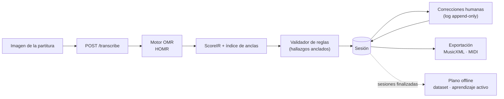

# Cadenza

[](https://github.com/sebdavid3/Cadenza/actions/workflows/ci.yml)

**Digitalización asistida de partituras.** Cadenza convierte la imagen de una partitura
en notación editable (MusicXML y MIDI). Un motor de reconocimiento óptico de música (OMR)
propone la transcripción, un validador de reglas musicales señala los compases
sospechosos y una persona la corrige. Cada corrección se guarda como un evento inmutable
que, más adelante, sirve para entrenar al sistema (aprendizaje activo).

Es el proyecto de una tesis: el backend está completo y el siguiente paso es la interfaz
de corrección en el navegador.

---

## Contenido

- [Cómo funciona](#cómo-funciona)
- [Estado](#estado)
- [Arquitectura](#arquitectura)
- [Requisitos](#requisitos)
- [Instalación](#instalación)
- [Arranque local](#arranque-local)
- [Configuración](#configuración)
- [API v1](#api-v1)
- [Interfaz web](#interfaz-web)
- [Calidad e integración continua](#calidad-e-integración-continua)
- [Despliegue con Docker Compose](#despliegue-con-docker-compose)
- [Plano offline y experimentos](#plano-offline-y-experimentos)
- [Estructura del repositorio](#estructura-del-repositorio)
- [Documentación](#documentación)
- [Cómo contribuir](#cómo-contribuir)

---

## Cómo funciona



1. **Transcripción.** `POST /transcribe` recibe una imagen, ejecuta el motor OMR configurado
   y obtiene un `ScoreIR`: la partitura en una representación intermedia neutral. Cada
   evento musical tiene un **ancla** (parte, pentagrama, compás, voz y posición).
2. **Validación.** Un motor de reglas (compases mal medidos, armaduras incoherentes, etc.)
   marca **hallazgos** anclados a los eventos sospechosos.
3. **Corrección.** La persona corrige con ediciones atómicas (`SetPitch`, `SetDuration`,
   `InsertEvent`…). Cada edición se añade a un log inmutable con control de concurrencia
   optimista (`base_seq`). El servidor valida el contenido de la edición, fija su autor y
   guarda el estado previo, de modo que **deshacer** restaura siempre el estado exacto
   ([ADR-0007](docs/adr/ADR-0007-edit-events-inmutables.md),
   [ADR-0011](docs/adr/ADR-0011-semantica-de-anclas-ante-ediciones.md),
   [ADR-0017](docs/adr/ADR-0017-validacion-del-contenido-de-las-ediciones.md)).
4. **Cierre y exportación.** La sesión se revalida, se finaliza y se exporta a MusicXML o
   MIDI.
5. **Aprendizaje.** El plano offline construye datasets con las correcciones de las sesiones
   finalizadas, elige qué muestras anotar y registra versiones de modelo. Los dos planos solo
   se comunican a través de datos persistidos
   ([ADR-0003](docs/adr/ADR-0003-separacion-planos-computo.md)).

---

## Estado

| Área | Estado |
|---|---|
| Dominio, OMR, validación, persistencia, API y plano offline (fases 0 a 7) | Completos |
| Contrato de la API v1 (OpenAPI 3.1.0, 24 endpoints) | Congelado en [`docs/api/openapi.json`](docs/api/openapi.json) |
| Interfaz web en `apps/web` (fase 8) | Vaciada en [#129](https://github.com/sebdavid3/Cadenza/issues/129) (solo quedan los tipos generados del contrato); se construye desde cero en la fase 8 |
| Evaluación en SMB y MUSCIMA++ ([#102](https://github.com/sebdavid3/Cadenza/issues/102)) y ajuste fino real del modelo ([#103](https://github.com/sebdavid3/Cadenza/issues/103)) | Alcance por decidir |
| Estudio de esfuerzo con participantes | Protocolo listo, estudio no realizado |

El entrenamiento del plano offline usa hoy un entrenador de prueba (`FakeTrainer`); el
ajuste fino real del modelo OMR es [#103](https://github.com/sebdavid3/Cadenza/issues/103).

Las cifras medidas (calidad OMR, precisión del validador, latencia), la deuda técnica y la
bitácora están en [`docs/PROJECT_STATE.md`](docs/PROJECT_STATE.md), con el experimento que
produce cada una.

---

## Arquitectura

Monolito modular con arquitectura hexagonal (puertos y adaptadores)
([ADR-0001](docs/adr/ADR-0001-monolito-modular-hexagonal.md)). El dominio es puro y la
lógica de cada caso de uso vive en la capa de aplicación; la notación, el OMR, la
validación, la base de datos y la API son adaptadores intercambiables.

| Paquete | Responsabilidad |
|---|---|
| [`packages/domain`](packages/domain) | Núcleo puro, solo biblioteca estándar: `ScoreIR`, anclas, `EditEvent`, hallazgos, proyección del log, mapa de tiempo y reglas de contenido de las ediciones |
| [`packages/application`](packages/application) | Casos de uso (transcribir, editar, deshacer, revalidar, finalizar, exportar…) y puertos ([ADR-0009](docs/adr/ADR-0009-capa-de-aplicacion.md)) |
| [`packages/interchange`](packages/interchange) | Frontera de notación: MusicXML ↔ `ScoreIR` y exportación a MusicXML y MIDI con music21 |
| [`packages/omr`](packages/omr) | Puerto `OMREngine` y adaptador HOMR (único motor, [ADR-0018](docs/adr/ADR-0018-homr-como-unico-motor-omr.md)); doble de pruebas en `cadenza.omr.testing`; preprocesado de imagen |
| [`packages/validation`](packages/validation) | Motor de reglas musicales y hallazgos anclados |
| [`packages/persistence`](packages/persistence) | SQLAlchemy (PostgreSQL con JSONB o SQLite), repositorios, almacén de artefactos y migraciones Alembic |
| [`packages/learning`](packages/learning) | Dataset desde la base de datos, estrategias de adquisición, métricas OMR-NED y SER, registro de modelos |
| [`apps/api`](apps/api) | API REST FastAPI del plano online, autenticación JWT y CLI administrativa |
| [`apps/web`](apps/web) | Interfaz web de corrección (fase 8); hoy solo contiene los tipos TypeScript generados del contrato |
| [`ml/`](ml) | CLI de jobs offline y experimentos de la tesis |

Reglas que no se rompen (verificadas por tests y por revisión): el dominio solo usa la
biblioteca estándar; la aplicación no importa FastAPI, SQLAlchemy, music21 ni los motores
OMR; music21 solo se usa en `interchange`; el log de ediciones es *append-only* y nunca
guarda una edición inválida; el autor de una edición lo fija el servidor
([ADR-0012](docs/adr/ADR-0012-autenticacion-e-identidad.md)). La lista completa está en
[`CLAUDE.md`](CLAUDE.md) §10 y el diseño en [`docs/ARCHITECTURE.md`](docs/ARCHITECTURE.md).

---

## Requisitos

- **Python 3.12** (el proyecto exige `>=3.12,<3.13`).
- **[uv](https://docs.astral.sh/uv/)**, que gestiona el workspace y el entorno virtual.
- Opcional: **GPU NVIDIA** para acelerar HOMR, con `onnxruntime-gpu` 1.26.0 (CUDA 12).
- Opcional: **Docker** con Docker Compose para el despliegue con PostgreSQL.

---

## Instalación

```bash
git clone https://github.com/sebdavid3/Cadenza.git
cd Cadenza
uv sync --inexact
```

Esto instala todos los paquetes del workspace y las herramientas de desarrollo (pytest,
mypy, ruff, black). Los tests ya pasan: usan un doble de pruebas del motor OMR y no necesitan
HOMR.

### Motor OMR: HOMR

HOMR es el único motor OMR de Cadenza
([ADR-0018](docs/adr/ADR-0018-homr-como-unico-motor-omr.md)). Sin él la API arranca, pero
`POST /transcribe` responde 500. Se instala como extra del paquete `cadenza-omr`:

```bash
uv pip install -e "packages/omr[homr]"
```

Para HOMR en GPU, sustituye `onnxruntime` por la build con CUDA:

```bash
uv pip uninstall onnxruntime onnxruntime-gpu
uv pip install "onnxruntime-gpu[cuda,cudnn]==1.26.0"
```

> [!WARNING]
> **No ejecutes `uv sync` a secas** después de instalar los extras. HOMR es un
> extra que un `uv sync` normal no selecciona, y `onnxruntime-gpu` 1.26.0 no figura
> en el *lockfile*: `uv sync` los desinstala sin avisar y los tests del motor real pasan a
> omitirse. Usa siempre `uv sync --inexact` para sincronizar y `uv run --no-sync` para
> ejecutar.

---

## Arranque local

La API **no lee archivos `.env`**: toma la configuración de las variables de entorno del
proceso. Para desarrollo basta con SQLite y HOMR instalado.

**PowerShell (Windows):**

```powershell
$env:CADENZA_AUTH_SECRET_KEY = "<cadena aleatoria de 32 caracteres o más>"
$env:CADENZA_DATABASE_URL    = "sqlite+pysqlite:///C:/ruta/fuera/del/repo/cadenza.db"
$env:CADENZA_ARTIFACTS_DIR   = "C:\ruta\fuera\del\repo\artifacts"
$env:CADENZA_OMR_USE_GPU     = "false"    # "true" para HOMR en GPU
```

**Bash (Linux, macOS):**

```bash
export CADENZA_AUTH_SECRET_KEY="<cadena aleatoria de 32 caracteres o más>"
export CADENZA_DATABASE_URL="sqlite+pysqlite:////ruta/fuera/del/repo/cadenza.db"
export CADENZA_ARTIFACTS_DIR="/ruta/fuera/del/repo/artifacts"
export CADENZA_OMR_USE_GPU="false"        # "true" para HOMR en GPU
```

Crea el primer usuario. No hay registro público
([ADR-0012](docs/adr/ADR-0012-autenticacion-e-identidad.md)); con SQLite, este comando crea
también el esquema de la base de datos:

```bash
uv run --no-sync python -m cadenza.api.cli create-investigator --username admin --password "<mínimo 8 caracteres>"
```

Arranca la API:

```bash
uv run --no-sync uvicorn cadenza.api.main:create_default_app --factory --host 127.0.0.1 --port 8000
```

- Documentación interactiva: <http://127.0.0.1:8000/docs>
- Estado del servicio: <http://127.0.0.1:8000/health>

La guía de integración para el frontend, con ejemplos reales de cada respuesta, está en
[`docs/api/frontend-handoff.md`](docs/api/frontend-handoff.md).

---

## Configuración

Todas las variables llevan el prefijo `CADENZA_` y se leen del entorno del proceso
(`apps/api/src/cadenza/api/settings.py`).

| Variable | Por defecto | Uso |
|---|---|---|
| `CADENZA_AUTH_SECRET_KEY` | *(vacía)* | Clave de firma de los tokens JWT. **Obligatoria**: sin ella la API no arranca. |
| `CADENZA_DATABASE_URL` | `sqlite+pysqlite:///./cadenza.db` | URL de SQLAlchemy: SQLite en local, PostgreSQL en despliegue. |
| `CADENZA_ARTIFACTS_DIR` | `./data/artifacts` | Directorio del almacén de artefactos (imágenes y exportaciones). |
| `CADENZA_OMR_USE_GPU` | `false` | Intentar la inferencia de HOMR en GPU. |
| `CADENZA_AUTH_TOKEN_EXPIRE_MINUTES` | `30` | Validez de los tokens de acceso. |
| `CADENZA_MAX_UPLOAD_SIZE_BYTES` | `20971520` | Tamaño máximo de imagen (20 MB). |
| `CADENZA_AUTO_CREATE_SCHEMA` | `false` | Crear el esquema al arrancar (solo desarrollo y tests). |
| `CADENZA_CORS_ORIGINS` | `*` | Orígenes CORS: `*`, un origen, lista separada por comas o lista JSON. |
| `CADENZA_LOGIN_RATE_LIMIT_MAX_ATTEMPTS` | `5` | Intentos de login fallidos antes del bloqueo temporal. |
| `CADENZA_LOGIN_RATE_LIMIT_WINDOW_SECONDS` | `300` | Ventana del límite de intentos de login. |
| `CADENZA_OMR_PREPROCESS_ENABLED` | `false` | Activar el preprocesado de imagen antes del OMR. |
| `CADENZA_OMR_PREPROCESS_DESKEW` / `_BINARIZE` / `_RESCALE` | `false` | Pasos del preprocesado: enderezado, binarización y reescalado. |
| `CADENZA_OMR_PREPROCESS_TARGET_DPI` | `300` | Resolución objetivo del reescalado. |
| `CADENZA_DISABLE_POWER_THROTTLING` | `true` | En Windows, pedir al sistema que no limite la energía del proceso ([ADR-0016](docs/adr/ADR-0016-transcripcion-sincrona-vs-asincrona.md)). |

Operación, registros, copias de seguridad y GPU:
[`docs/infra/operacion_backend.md`](docs/infra/operacion_backend.md).

---

## API v1

Todas las rutas salvo `/health`, `/version` y `/auth/login` requieren un token Bearer JWT.
Un transcriptor solo accede a sus sesiones; un investigador ve todas, edita solo las suyas
y administra las cuentas ([ADR-0012](docs/adr/ADR-0012-autenticacion-e-identidad.md)).

| Área | Endpoints |
|---|---|
| Sistema | `GET /health` · `GET /version` |
| Autenticación | `POST /auth/login` · `GET /auth/me` · `POST /auth/password` |
| Usuarios (investigador) | `GET /users` · `POST /users` · `PATCH /users/{user_id}` |
| Transcripción | `POST /transcribe` |
| Sesiones | `GET /sessions` · `GET /sessions/{id}` · `GET /sessions/{id}/image` · `GET /sessions/{id}/export?format=musicxml\|midi` · `GET /sessions/{id}/timing` |
| Edición | `POST /sessions/{id}/edits` · `POST /sessions/{id}/undo` |
| Hallazgos | `GET /sessions/{id}/findings` · `POST /sessions/{id}/validate` · `POST /sessions/{id}/findings/{finding_id}/dismiss` · `POST /sessions/{id}/findings/{finding_id}/restore` |
| Ciclo de vida | `POST /sessions/{id}/finalize` · `POST /sessions/{id}/reopen` |
| Esfuerzo | `POST /sessions/{id}/effort` · `GET /sessions/{id}/effort` |

`POST /transcribe` es síncrono ([ADR-0016](docs/adr/ADR-0016-transcripcion-sincrona-vs-asincrona.md)).
El contrato se genera desde el código y no se edita a mano:

```bash
uv run --no-sync python scripts/generate_openapi_and_types.py   # docs/api/openapi.json y apps/web/src/types.ts
```

---

## Interfaz web

`apps/web` está vacía a propósito desde [#129](https://github.com/sebdavid3/Cadenza/issues/129):
la interfaz de corrección se construye desde cero en la fase 8. Solo contiene
`apps/web/src/types.ts`, los tipos TypeScript generados desde el contrato OpenAPI, que no se
editan a mano.

La fase 8 implementará el inicio de sesión, la ingesta, la corrección con el renderizado de la
partitura con OSMD y la reproducción con Tone.js
([ADR-0006](docs/adr/ADR-0006-render-editor-osmd-verovio-zustand.md)) sobre la API v1.
Punto de partida: [`docs/api/frontend-handoff.md`](docs/api/frontend-handoff.md).

---

## Calidad e integración continua

Antes de cada fusión pasan estas puertas:

```bash
uv run --no-sync pytest
uv run --no-sync mypy packages apps        # tipado estricto
uv run --no-sync ruff check .
uv run --no-sync black --check .
```

Cuando exista de nuevo una aplicación en `apps/web`, sus propias puertas (pruebas y build) se
añadirán a esta lista y a la CI.

La CI de GitHub Actions ([`.github/workflows/ci.yml`](.github/workflows/ci.yml)) ejecuta lo
mismo en cada PR hacia `dev`. Los tests de compatibilidad con PostgreSQL corren allí contra un
PostgreSQL 16 real; los del motor HOMR real se omiten porque la CI no lo instala.

---

## Despliegue con Docker Compose

[`docker-compose.yml`](docker-compose.yml) levanta PostgreSQL 16 y la API. Al arrancar, la
API aplica las migraciones de Alembic y sirve en el puerto 8000.

```bash
cp .env.example .env      # cambia la contraseña de PostgreSQL y la clave JWT
docker compose up --build
```

Docker Compose sí lee `.env` para sustituir variables en `docker-compose.yml`. El perfil
`batch` añade un contenedor con GPU que ejecuta la CLI offline
(`docker compose --profile batch run --rm ml-batch --help`).

La imagen de la API incluye HOMR en CPU con sus pesos ya descargados, así que transcribe sin
acceso a la red. Crea el primer usuario dentro del contenedor:

```bash
docker exec cadenza-api python -m cadenza.api.cli create-investigator --username <usuario> --password <contraseña>
```

> [!WARNING]
> La imagen del perfil `batch` (`Dockerfile.ml-cuda`) no se construye hoy (deuda D53).

> [!NOTE]
> **Alembic es solo para PostgreSQL.** Las migraciones usan tipos nativos como `JSONB` desde
> la `0001`, así que no se aplican sobre SQLite. En local con SQLite, el esquema lo crea
> `create-investigator`.

Migraciones a mano, con `CADENZA_DATABASE_URL` apuntando a PostgreSQL (también para `--sql`,
que genera el SQL sin conectarse):

```bash
uv run --no-sync alembic -c packages/persistence/alembic.ini upgrade head
uv run --no-sync alembic -c packages/persistence/alembic.ini downgrade -1
uv run --no-sync alembic -c packages/persistence/alembic.ini upgrade head --sql
```

Copias de seguridad de la base de datos y los artefactos, con verificación SHA-256:
`uv run --no-sync python scripts/backup_restore.py {backup,verify,restore}`.

---

## Plano offline y experimentos

El plano offline ([ADR-0008](docs/adr/ADR-0008-active-learning-model-registry.md)) se maneja
con una CLI:

```bash
uv run --no-sync python -m ml --help
# build-dataset · select · train · evaluate · promote · run · export-effort
```

Los experimentos de la tesis están en [`ml/experiments/`](ml/experiments). Escriben en
`results/` y leen los corpus de `data/`; las dos carpetas no se versionan.

| Script | Qué mide |
|---|---|
| `corpus.py` | Registro, descarga y manifiesto con hashes de los corpus (`info`, `fetch`, `manifest`) |
| `exp_01_effort.py` | Reducción del esfuerzo de inspección gracias al validador |
| `exp_02_active_learning.py` | Comparación de estrategias de aprendizaje activo |
| `exp_03_omr_quality.py` | Calidad de HOMR (OMR-NED y SER) frente a la verdad de referencia |
| `exp_04_homr_transcribe.py` | Transcripción real del corpus con HOMR |
| `exp_05_edit_derivation.py` | Derivación de ediciones a partir de errores reales del OMR |
| `exp_06_validation_metrics.py` | Precisión y *recall* del validador |
| `exp_07_preprocessing_impact.py` | Efecto del preprocesado de imagen sobre HOMR |
| `exp_09_multicorpus_evaluation.py` | Evaluación en SMB y MUSCIMA++ (alcance por decidir, [#102](https://github.com/sebdavid3/Cadenza/issues/102)) |
| `exp_10_effort_study.py` | Exportación del estudio de esfuerzo (hoy con datos sintéticos) |
| `exp_11_latency_benchmark.py` | Latencia de transcripción con HOMR en CPU y GPU |

```bash
uv run --no-sync python ml/experiments/corpus.py info
uv run --no-sync python ml/experiments/exp_11_latency_benchmark.py --help
```

`results/` es la evidencia de la tesis: una cifra solo cuenta si sale de una ejecución real,
lo simulado se marca como tal y nada se cita sin regenerarlo (`CLAUDE.md` §8). Más detalle de
cada experimento en [`ml/README.md`](ml/README.md).

---

## Estructura del repositorio

```text
Cadenza/
├── apps/
│   ├── api/                 API REST (FastAPI) y CLI administrativa
│   └── web/                 Tipos generados del contrato; la interfaz web es la fase 8
├── packages/                Monolito modular: un paquete por módulo del workspace uv
│   ├── domain/              Núcleo puro
│   ├── application/         Casos de uso y puertos
│   ├── interchange/         Frontera de notación (music21)
│   ├── omr/                 Motor OMR (HOMR) y preprocesado
│   ├── validation/          Motor de reglas
│   ├── persistence/         Base de datos, artefactos y migraciones Alembic
│   └── learning/            Dataset, aprendizaje activo y métricas
├── ml/                      CLI offline y experimentos de la tesis
├── scripts/                 Contrato OpenAPI y copias de seguridad
├── configs/                 Configuraciones de entrenamiento
├── docs/                    Arquitectura, ADR, estado, guía de la API, operación
├── latex/                   Documento de la tesis
├── legacy/                  Prototipo original, congelado
├── data/                    Corpus descargados (no versionado)
└── results/                 Resultados de experimentos (no versionado)
```

---

## Documentación

| Documento | Contenido |
|---|---|
| [`docs/PROJECT_STATE.md`](docs/PROJECT_STATE.md) | Estado vivo: fase, deuda técnica, resultados y bitácora |
| [`docs/ARCHITECTURE.md`](docs/ARCHITECTURE.md) | Arquitectura objetivo, casos de uso, modelo de datos y estado real |
| [`docs/adr/`](docs/adr) | Decisiones de arquitectura (ADR-0001 a ADR-0017) |
| [`docs/api/frontend-handoff.md`](docs/api/frontend-handoff.md) | Guía de integración de la API v1 para el frontend |
| [`docs/infra/operacion_backend.md`](docs/infra/operacion_backend.md) | Despliegue, salud, registros, copias y GPU |
| [`docs/investigaciones/`](docs/investigaciones) | Investigaciones técnicas (INV-0001: cajas y confianza de HOMR) |
| [`docs/experimentos/`](docs/experimentos) | Protocolo del estudio de esfuerzo |
| [`docs/literatura/`](docs/literatura) | Estado del arte y corpus |
| [`docs/CONVENTIONS.md`](docs/CONVENTIONS.md) | Convenciones de Git y definición de terminado |
| [`docs/migracion_legacy.md`](docs/migracion_legacy.md) | Paridad con el prototipo y plan de retiro de `legacy/` |

---

## Cómo contribuir

Las reglas de trabajo están en [`CLAUDE.md`](CLAUDE.md) y
[`docs/CONVENTIONS.md`](docs/CONVENTIONS.md). En resumen:

- Un issue, una rama (`<tipo>/<número>-<descripción>`) y un PR hacia `dev`; `main` no se
  toca.
- Commits en español con Conventional Commits (`fix(api): …`), añadiendo archivos con rutas
  explícitas.
- Primero el test que expresa el criterio o reproduce el fallo, después el código.
- Las puertas de calidad en verde, una revisión independiente del diff y la documentación
  al día antes de fusionar con *squash*.

El prototipo original (FastAPI + HOMR + OSMD + Tone.js) se conserva congelado en `legacy/`
y en la etiqueta `archive/legacy-mvp`.

El proyecto declara licencia propietaria (`pyproject.toml`).
