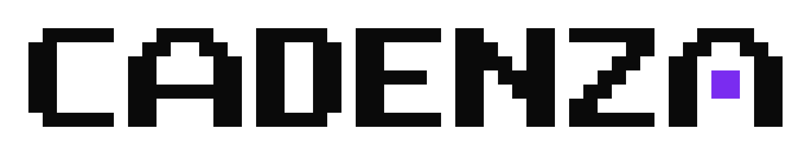
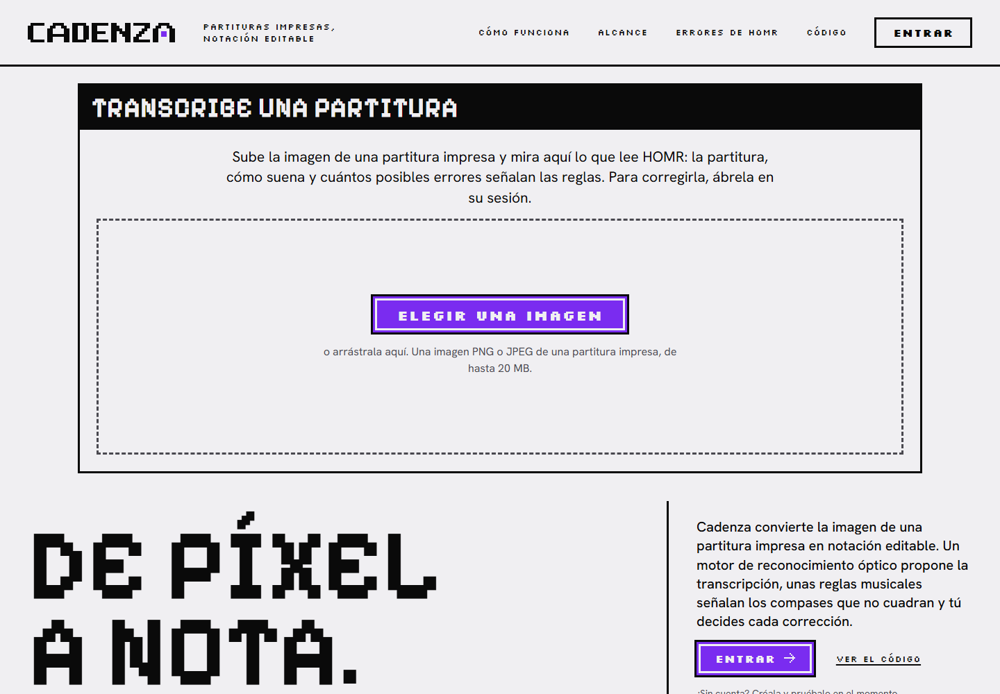
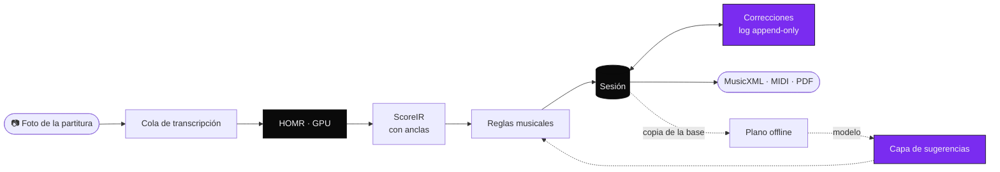
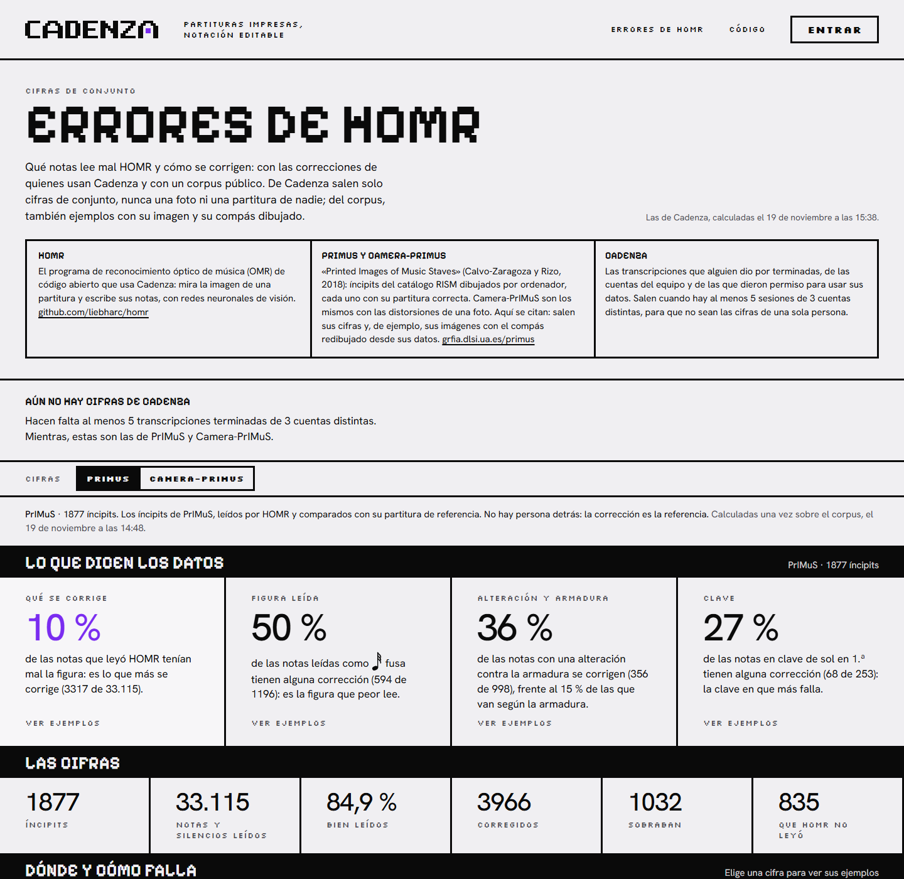
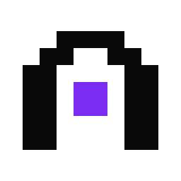

<div align="center">

<br>

<picture>
  <source media="(prefers-color-scheme: dark)" srcset="docs/marca/svg/cadenza-palabra-invertido.svg">
  
</picture>

<br>

### De píxel a nota.

**Haz una foto a una partitura impresa y conviértela en notación editable.**<br>
Una máquina propone la transcripción, unas reglas musicales señalan lo que no cuadra<br>
y tú decides cada corrección. Cada corrección enseña a la siguiente.

<br>

[](https://cadenza.sebdavid.dev)
[](https://cadenza.sebdavid.dev/errores-de-homr)


[](LICENSE)

[Qué hace](#-qué-hace) ·
[Cómo funciona](#-cómo-funciona) ·
[Empezar](#-empezar-en-local) ·
[Arquitectura](#-arquitectura) ·
[Documentación](#-documentación) ·
[Contribuir](#-contribuir)

</div>

<br>

<p align="center">
  
</p>

---

## ▪ La idea

En música, la **cadenza** es el momento en que la orquesta se detiene sobre un calderón y el solista toma la palabra. Por eso la última A del logo no tiene travesaño: tiene un punto, un calderón. Es el instante en que la máquina se para y **te toca a ti**.

Los lectores ópticos de música (OMR) leen bien una partitura, pero no perfecta: una figura mal leída, una alteración que sobra, una clave equivocada. Cadenza no esconde esos errores. Los marca sobre la propia partitura, junto a la foto, explicados en lenguaje musical, y te da una mesa de corrección pensada para arreglarlos rápido. Cada arreglo queda guardado como un evento inmutable, y con ellos la plataforma aprende a sugerir el siguiente.

> [!NOTE]
> **Cadenza está abierto.** Desde el 2026-11-11 está en pruebas con público en **[cadenza.sebdavid.dev](https://cadenza.sebdavid.dev)**, con registro libre. Es el proyecto de una tesis; su estado al día vive en [`docs/PROJECT_STATE.md`](docs/PROJECT_STATE.md).

---

## ▪ Qué hace

<table>
<tr>
<td width="50%" valign="top">

### 📷 Transcribe
Sube una o varias imágenes (PNG o JPEG, hasta 20 MB) y sigue el avance de cada una mientras **HOMR** la lee en la GPU. Una página de voz y piano tarda de 16 a 20 segundos.

</td>
<td width="50%" valign="top">

### 🔍 Señala
Un motor de reglas marca los **posibles errores** de cada compás: compases que no suman, alteraciones repetidas, notas fuera de registro… explicados como lo diría un músico.

</td>
</tr>
<tr>
<td valign="top">

### ✏️ Corrige
Sobre la partitura, con la barra o el teclado: altura, figura, acordes, ligaduras, voces, clave, armadura, compás, dinámicas y articulaciones. Con **deshacer y rehacer** exactos.

</td>
<td valign="top">

### 🎧 Escucha y exporta
La partitura suena con el compás resaltado junto a la foto original. Al terminar, descárgala en **MusicXML, MIDI o PDF**.

</td>
</tr>
<tr>
<td colspan="2" valign="top">

### ✨ Aprende
Cada corrección alimenta un corpus. Con él se entrena la **capa de sugerencias**, que propone el arreglo de cada posible error para que lo aceptes o lo rechaces de un clic. Está activa en producción desde el 2026-11-03.

</td>
</tr>
</table>

### La mesa de corrección

| | Qué puedes cambiar |
|---|---|
| **Altura** | Un paso arriba o abajo, una octava, sostenidos, bemoles y becuadros |
| **Figura** | De semifusa a redonda, puntillo y tresillos |
| **Notas** | Insertar y borrar notas y silencios, formar acordes, notas de adorno y ligaduras de prolongación |
| **Compás** | Clave, armadura e indicación de compás, en una parte o en todas a la vez |
| **Marcas** | Articulaciones, calderones, dinámicas, ligaduras de expresión y reguladores |
| **Voces** | Varias voces por pentagrama, con sus huecos |
| **Ratón** | Escribir notas directamente sobre la partitura |

---

## ▪ Cómo funciona



1. **Leer.** La imagen entra en una cola y HOMR, el motor OMR, la transcribe en segundo plano ([ADR-0064](docs/adr/ADR-0064-transcripcion-en-segundo-plano-con-su-avance.md), [ADR-0018](docs/adr/ADR-0018-homr-como-unico-motor-omr.md)). Su MusicXML se importa a un **`ScoreIR`**, una representación neutral donde cada evento tiene un **ancla**: parte, pentagrama, compás, voz y posición. Una etapa propia arregla el compás que HOMR lee mal ([ADR-0059](docs/adr/ADR-0059-compas-por-tramos-c-y-cortado-y-tresillos-implicitos-tras-homr.md)).
2. **Señalar.** Las reglas musicales marcan los posibles errores, anclados a su compás.
3. **Corregir.** Cada edición es atómica (`SetPitch`, `SetDuration`, `InsertEvent`, `SetTie`…) y entra en un log que solo crece, con concurrencia optimista (`base_seq`). El servidor valida el contenido, fija el autor y guarda el estado previo, así que deshacer devuelve siempre el estado exacto ([ADR-0007](docs/adr/ADR-0007-edit-events-inmutables.md), [ADR-0011](docs/adr/ADR-0011-semantica-de-anclas-ante-ediciones.md), [ADR-0017](docs/adr/ADR-0017-validacion-del-contenido-de-las-ediciones.md)).
4. **Aprender.** Un plano offline, sobre una copia de la base, construye el corpus de correcciones, recorta cada pentagrama de la foto junto a lo que leyó HOMR y lo que quedó corregido, y entrena la capa de sugerencias ([ADR-0036](docs/adr/ADR-0036-capa-de-sugerencias-aprendida.md), [ADR-0067](docs/adr/ADR-0067-captura-de-homr-y-recortes-de-los-pentagramas.md)). Los dos planos solo se hablan mediante datos guardados ([ADR-0003](docs/adr/ADR-0003-separacion-planos-computo.md)).

### Qué lee mal HOMR, a la vista de todos

La página pública **[Errores de HOMR](https://cadenza.sebdavid.dev/errores-de-homr)** reúne en cifras de conjunto lo que el lector se equivoca y cómo se corrige: con las correcciones de quienes usan Cadenza (nunca una foto ni una partitura de nadie) y con los corpus públicos PrIMuS y Camera-PrIMuS, con ejemplos de su imagen y su compás redibujado.

<p align="center">
  
</p>

---

## ▪ Empezar en local

<details open>
<summary><b>Requisitos</b></summary>

- Python 3.12 y [uv](https://docs.astral.sh/uv/)
- Node.js 22.12 o posterior, para la web
- Opcionales: una GPU NVIDIA con CUDA 12 para HOMR, y Docker para desplegar con PostgreSQL

</details>

**1. El backend y el motor**

```bash
git clone https://github.com/sebdavid3/Cadenza.git
cd Cadenza
uv sync --inexact
uv pip install -e "packages/omr[homr]"
```

> [!WARNING]
> **Nunca ejecutes `uv sync` a secas.** HOMR y `onnxruntime-gpu` se instalan aparte, y un `uv sync` normal los desinstala sin avisar: los tests del motor real pasan a omitirse y nadie lo nota. Usa siempre `uv sync --inexact` y `uv run --no-sync`.

<details>
<summary>HOMR en la GPU</summary>

```bash
uv pip uninstall onnxruntime onnxruntime-gpu
uv pip install "onnxruntime-gpu[cuda,cudnn]==1.26.0"
```

Y después `CADENZA_OMR_USE_GPU="true"`.

</details>

**2. La API.** Toma la configuración del entorno (no lee `.env`); con SQLite basta para desarrollar:

```bash
export CADENZA_AUTH_SECRET_KEY="$(openssl rand -hex 32)"
export CADENZA_DATABASE_URL="sqlite+pysqlite:////ruta/fuera/del/repo/cadenza.db"
export CADENZA_ARTIFACTS_DIR="/ruta/fuera/del/repo/artifacts"
export CADENZA_AUTO_CREATE_SCHEMA="true"
export CADENZA_REGISTRATION_ENABLED="true"

uv run --no-sync uvicorn cadenza.api.main:create_default_app --factory --host 127.0.0.1 --port 8000
```

En PowerShell, cada `export` es `$env:NOMBRE = "valor"`. La documentación interactiva queda en <http://127.0.0.1:8000/docs>.

**3. La web**

```bash
cd apps/web
npm ci
npm run dev    # http://localhost:5173
```

El servidor de desarrollo reenvía `/api/` a la API, sin CORS que configurar.

<details>
<summary><b>Configuración</b>: las variables principales</summary>

Todas llevan el prefijo `CADENZA_` y están en [`settings.py`](apps/api/src/cadenza/api/settings.py).

| Variable | Por defecto | Uso |
|---|---|---|
| `CADENZA_AUTH_SECRET_KEY` | — | Clave de los tokens JWT. **Obligatoria**, de 32 bytes como mínimo |
| `CADENZA_DATABASE_URL` | `sqlite+pysqlite:///./cadenza.db` | SQLite en local, PostgreSQL en despliegue |
| `CADENZA_ARTIFACTS_DIR` | `./data/artifacts` | Imágenes y exportaciones |
| `CADENZA_OMR_USE_GPU` | `false` | HOMR en la GPU, si la hay |
| `CADENZA_REGISTRATION_ENABLED` | `false` | Registro libre, con el permiso de datos; exige `CADENZA_CORS_ORIGINS` sin `*` |
| `CADENZA_SUGGESTIONS_ENABLED` | `false` | Capa de sugerencias (necesita un modelo promovido) |
| `CADENZA_MAX_UPLOAD_SIZE_BYTES` | `20971520` | Tamaño máximo de imagen (20 MB) |
| `CADENZA_CORS_ORIGINS` | `*` | Orígenes permitidos |

</details>

<details>
<summary><b>Con Docker</b>: PostgreSQL y la API en un comando</summary>

```bash
cp .env.example .env        # contraseña de PostgreSQL y clave JWT
docker compose up --build
```

La imagen trae HOMR con sus pesos, así que transcribe sin red; con `--build-arg CADENZA_OMR_DEVICE=gpu` lleva además ONNX Runtime con CUDA ([ADR-0066](docs/adr/ADR-0066-homr-en-la-gpu-de-produccion.md)). Producción usa [`docker-compose.prod.yml`](docker-compose.prod.yml), con la web, Nginx y la API en la GPU; la operación completa está en [`docs/infra/operacion_backend.md`](docs/infra/operacion_backend.md).

</details>

---

## ▪ Arquitectura

Un **monolito modular hexagonal** ([ADR-0001](docs/adr/ADR-0001-monolito-modular-hexagonal.md)): un dominio puro en el centro, los casos de uso alrededor y adaptadores intercambiables para la notación, el OMR, la validación, la base de datos y la web.

```text
cadenza/
├── packages/
│   ├── domain/         núcleo puro: ScoreIR, anclas, ediciones, posibles errores
│   ├── application/    casos de uso y sus puertos
│   ├── interchange/    MusicXML ↔ ScoreIR, MIDI (el único sitio con music21)
│   ├── omr/            adaptador de HOMR, etapa del compás, captura
│   ├── validation/     reglas musicales y capa de sugerencias
│   ├── persistence/    SQLAlchemy, repositorios y migraciones Alembic
│   └── learning/       corpus de correcciones, métricas y entrenamiento
├── apps/
│   ├── api/            FastAPI, autenticación JWT y CLI administrativa
│   └── web/            React 18 + TypeScript + Vite, OSMD y Tone.js
└── ml/                 plano offline y experimentos de la tesis
```

**Reglas que no se rompen**, comprobadas por los tests:

- 🧱 El dominio solo usa la biblioteca estándar.
- 🔌 La aplicación no importa FastAPI, SQLAlchemy, music21 ni el OMR.
- 🎼 music21 solo vive en `interchange`.
- 📜 El log de ediciones solo crece y nunca guarda una edición inválida.
- 🔐 El autor de cada edición lo fija el servidor.

La **API v1** se describe en [`openapi.json`](docs/api/openapi.json), generado desde el código junto a los tipos de la web, y solo admite cambios compatibles. Su guía de integración, con ejemplos reales, está en [`frontend-handoff.md`](docs/api/frontend-handoff.md).

---

## ▪ Documentación

| | |
|---|---|
| 🧭 [`PROJECT_STATE.md`](docs/PROJECT_STATE.md) | **Lo primero que hay que leer:** fase, próximo paso, deuda y bitácora |
| 🏛️ [`ARCHITECTURE.md`](docs/ARCHITECTURE.md) | Arquitectura, casos de uso, modelo de datos y estado real |
| 📐 [`docs/adr/`](docs/adr/README.md) | Todas las decisiones de arquitectura, con su índice |
| 🔗 [`docs/api/`](docs/api/frontend-handoff.md) | El contrato de la API v1 y su guía |
| 🚀 [`operacion_backend.md`](docs/infra/operacion_backend.md) | Despliegue, salud, registros, copias y GPU |
| 🧪 [`ml/README.md`](ml/README.md) | El plano offline y los experimentos de la tesis |
| 🔬 [`docs/investigaciones/`](docs/investigaciones) | Investigaciones técnicas sobre HOMR |
| 🎨 [`PRODUCT.md`](PRODUCT.md) · [`DESIGN.md`](DESIGN.md) · [`docs/marca/`](docs/marca/GUIA-DE-USO.md) | El producto, su sistema de diseño y la guía del logo |
| 📏 [`CONVENTIONS.md`](docs/CONVENTIONS.md) | Git, calidad, niveles de cambio y definición de terminado |

> [!IMPORTANT]
> `results/` es la evidencia de la tesis: una cifra solo cuenta si sale de una ejecución real, lo simulado se marca como tal y nada se cita sin regenerarlo antes ([`CLAUDE.md`](CLAUDE.md) §8).

---

## ▪ Contribuir

- **Un issue, una rama, un PR** hacia `dev`, con ramas `<tipo>/<número>-<descripción>`. `main` solo se actualiza promoviendo `dev`.
- **Commits en español** con Conventional Commits: `fix(api): …`, `feat(web): …`.
- **Pruebas primero:** el test que expresa el criterio o reproduce el fallo, y después el código.
- **Puertas en verde** antes de fusionar con *squash*:

  ```bash
  uv run --no-sync python scripts/puertas.py
  ```

  ruff, black, mypy estricto y pytest para Python; ESLint, Prettier, Vitest y la compilación para la web; y la comprobación de que el contrato sigue al código.

Las reglas completas están en [`CLAUDE.md`](CLAUDE.md) y [`docs/CONVENTIONS.md`](docs/CONVENTIONS.md).

---

## ▪ Licencia y créditos

Cadenza se distribuye con la **[GNU Affero General Public License v3.0 o posterior](LICENSE)** ([#259](https://github.com/sebdavid3/Cadenza/issues/259)). Es la licencia de HOMR, que Cadenza importa y modifica en ejecución, y la aplicación se ofrece por red: por eso la web enlaza a este repositorio, para que quien la use pueda obtener su código.

- **[HOMR](https://github.com/liebharc/homr)** 0.7.0, AGPL-3.0: el motor de reconocimiento.
- **[PrIMuS y Camera-PrIMuS](https://grfia.dlsi.ua.es/primus/)** (Calvo-Zaragoza y Rizo, 2018): los corpus de las mediciones. Se citan y no se redistribuyen.
- **Fuentes:** Hanken Grotesk, Pixelify Sans y Silkscreen, y los contornos de Noto Music, todas con la SIL Open Font License 1.1.
- **Retratos del acceso:** cinco imágenes de Wikimedia Commons, con su fuente en [`retratos/README.md`](apps/web/src/pages/login/retratos/README.md).
- **Sonido:** sintetizado con Tone.js, sin muestras de audio ([ADR-0046](docs/adr/ADR-0046-sonido-de-cada-instrumento-en-la-vista.md)).

<br>

<div align="center">
  <picture>
    <source media="(prefers-color-scheme: dark)" srcset="docs/marca/svg/cadenza-simbolo-invertido.svg">
    
  </picture>
  <br>
  <sub>La máquina se detiene. <b>Te toca a ti.</b></sub>
</div>
