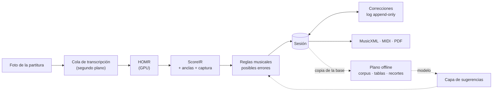

# Cadenza

**De la foto de una partitura a una partitura editable, corregida por una persona y aprovechada para aprender.**

Cadenza lee la imagen de una partitura con un motor de reconocimiento óptico de música (OMR), señala los compases que probablemente están mal y deja que una persona corrija la transcripción sobre la propia partitura, junto a la foto. Cada corrección se guarda como un evento inmutable. Así, la plataforma acaba reuniendo los datos con los que reconocer los errores del lector y, algún día, entrenar uno mejor.

Es el proyecto de una tesis.

> [!NOTE]
> **Pruebas con público en curso.** Desde el 2026-11-11, Cadenza está abierto en **https://cadenza.sebdavid.dev**, con registro libre. Durante las pruebas el sistema está congelado: producción no cambia salvo un arreglo que las bloquee. El estado al día está en [`docs/PROJECT_STATE.md`](docs/PROJECT_STATE.md).

---

## Contenido

- [Qué se puede hacer](#qué-se-puede-hacer)
- [Cómo funciona](#cómo-funciona)
- [Probarlo en local](#probarlo-en-local)
- [Configuración](#configuración)
- [Arquitectura](#arquitectura)
- [API v1](#api-v1)
- [Datos, aprendizaje y experimentos](#datos-aprendizaje-y-experimentos)
- [Calidad](#calidad)
- [Despliegue](#despliegue)
- [Documentación](#documentación)
- [Cómo contribuir](#cómo-contribuir)

---

## Qué se puede hacer

**Transcribir.**
- Subir una o varias imágenes (PNG o JPEG, hasta 20 MB) y seguir el avance de cada una mientras HOMR la lee.
- Una página completa de voz y piano tarda de 16 a 20 s en la GPU del servidor.
- Cada transcripción queda como una sesión, con su título, compositor e instrumentos.

**Revisar.**
- Ver la partitura dibujada junto a la imagen original y escucharla, con el compás que suena resaltado.
- Ver marcados los compases con posibles errores, con una explicación en lenguaje musical.

**Corregir sobre la partitura**, con la barra o con el teclado, en una mesa de corrección:

| Qué | Cómo |
|---|---|
| Altura y alteración | Un paso arriba o abajo, una octava, sostenidos, bemoles y becuadros |
| Figura | De semifusa a redonda, puntillo y tresillos |
| Notas | Insertar y borrar notas y silencios, formar acordes, notas de adorno y ligaduras de prolongación |
| Compás | Clave, armadura e indicación de compás, en una parte o en todas a la vez |
| Marcas | Articulaciones, calderones, dinámicas, ligaduras de expresión y reguladores |
| Voces | Varias voces por pentagrama, con sus huecos |
| Con el ratón | Escribir notas directamente sobre la partitura |

**Deshacer y rehacer** con la historia de ediciones; descartar, restaurar y revalidar los posibles errores.

**Terminar.** Finalizar o reabrir la sesión y descargarla en MusicXML, MIDI o PDF.

**Cuentas.** Registro libre con un permiso explícito de uso de los datos, que se puede retirar desde «Tu cuenta». Los investigadores moderan las cuentas.

---

## Cómo funciona



1. **Transcripción.**
   - La web sube la imagen a una cola, que la transcribe en segundo plano y avisa del avance ([ADR-0064](docs/adr/ADR-0064-transcripcion-en-segundo-plano-con-su-avance.md)).
   - HOMR, el único motor ([ADR-0018](docs/adr/ADR-0018-homr-como-unico-motor-omr.md)), da un MusicXML que se importa a un `ScoreIR`: la partitura en una representación neutral, donde cada evento tiene un **ancla** (parte, pentagrama, compás, voz y posición).
   - Una etapa propia corrige el compás que HOMR lee mal ([ADR-0059](docs/adr/ADR-0059-compas-por-tramos-c-y-cortado-y-tresillos-implicitos-tras-homr.md)).
   - La sesión guarda también la **captura de HOMR**: dónde está cada pentagrama en la foto, dónde empieza cada sistema y su MusicXML original ([ADR-0067](docs/adr/ADR-0067-captura-de-homr-y-recortes-de-los-pentagramas.md)).
2. **Validación.** Un motor de reglas marca **posibles errores** anclados a sus compases: compases que no suman, alteraciones repetidas, notas fuera de registro…
3. **Corrección.**
   - Cada edición es atómica (`SetPitch`, `SetDuration`, `InsertEvent`, `SetTie`…) y entra en un log que solo crece, con control de concurrencia optimista (`base_seq`).
   - El servidor valida su contenido, fija su autor y guarda el estado previo, así que **deshacer** devuelve siempre el estado exacto ([ADR-0007](docs/adr/ADR-0007-edit-events-inmutables.md), [ADR-0011](docs/adr/ADR-0011-semantica-de-anclas-ante-ediciones.md), [ADR-0017](docs/adr/ADR-0017-validacion-del-contenido-de-las-ediciones.md)).
4. **Aprendizaje.**
   - El plano offline trabaja sobre una copia de la base: construye el corpus de correcciones, exporta tablas y recortes para analizar los errores de HOMR y entrena la **capa de sugerencias**.
   - Esa capa propone el arreglo de cada posible error, y la persona lo aplica o lo rechaza ([ADR-0036](docs/adr/ADR-0036-capa-de-sugerencias-aprendida.md)). Está preparada, pero aún no tiene un modelo promovido.
   - Los dos planos solo se comunican por datos guardados ([ADR-0003](docs/adr/ADR-0003-separacion-planos-computo.md)).

---

## Probarlo en local

**Requisitos:**
- Python 3.12 y [uv](https://docs.astral.sh/uv/);
- Node.js 22.12 o posterior, para la web;
- opcionales: una GPU NVIDIA con CUDA 12 para HOMR, y Docker para el despliegue con PostgreSQL.

```bash
git clone https://github.com/sebdavid3/Cadenza.git
cd Cadenza
uv sync --inexact
uv pip install -e "packages/omr[homr]"     # HOMR, el motor OMR
```

Para HOMR en GPU, cambia ONNX Runtime por la versión con CUDA:

```bash
uv pip uninstall onnxruntime onnxruntime-gpu
uv pip install "onnxruntime-gpu[cuda,cudnn]==1.26.0"
```

> [!WARNING]
> **Nunca ejecutes `uv sync` a secas.** HOMR y `onnxruntime-gpu` se instalan aparte, y un `uv sync` normal los desinstala sin avisar: los tests del motor real pasan a omitirse y nadie lo nota. Usa `uv sync --inexact` y `uv run --no-sync`.

La API toma la configuración del entorno del proceso; no lee `.env`. Con SQLite basta para desarrollar:

```bash
export CADENZA_AUTH_SECRET_KEY="$(openssl rand -hex 32)"
export CADENZA_DATABASE_URL="sqlite+pysqlite:////ruta/fuera/del/repo/cadenza.db"
export CADENZA_ARTIFACTS_DIR="/ruta/fuera/del/repo/artifacts"
export CADENZA_OMR_USE_GPU="false"          # "true" con la GPU

# El primer usuario (con SQLite, crea también el esquema). Sin --password, la pide sin eco.
uv run --no-sync python -m cadenza.api.cli create-investigator --username admin

uv run --no-sync uvicorn cadenza.api.main:create_default_app --factory --host 127.0.0.1 --port 8000
```

En PowerShell, cada `export` es `$env:NOMBRE = "valor"`.

La documentación interactiva queda en <http://127.0.0.1:8000/docs> y el estado, en `/health`. Después, la web:

```bash
cd apps/web
npm ci
npm run dev            # http://localhost:5173
```

El servidor de desarrollo reenvía a la API lo que va bajo `/api/`, sin CORS que configurar. Para apuntar a otro backend, copia `apps/web/.env.example` como `.env.local` y ajusta `CADENZA_API_PROXY_TARGET`.

---

## Configuración

Las variables llevan el prefijo `CADENZA_` (`apps/api/src/cadenza/api/settings.py`). Las principales:

| Variable | Por defecto | Uso |
|---|---|---|
| `CADENZA_AUTH_SECRET_KEY` | — | Clave de los tokens JWT. **Obligatoria**, de 32 bytes como mínimo |
| `CADENZA_DATABASE_URL` | `sqlite+pysqlite:///./cadenza.db` | SQLite en local, PostgreSQL en despliegue |
| `CADENZA_ARTIFACTS_DIR` | `./data/artifacts` | Imágenes y exportaciones |
| `CADENZA_OMR_USE_GPU` | `false` | HOMR en la GPU, si la hay |
| `CADENZA_OMR_METER_FEATURES` | `numerator,symbol,implicit_tuplets` | Qué corrige la etapa del compás |
| `CADENZA_REGISTRATION_ENABLED` | `false` | Registro libre, con el permiso de datos; exige `CADENZA_CORS_ORIGINS` sin `*` |
| `CADENZA_SUGGESTIONS_ENABLED` | `false` | Capa de sugerencias (necesita un modelo promovido) |
| `CADENZA_MAX_UPLOAD_SIZE_BYTES` | `20971520` | Tamaño máximo de imagen (20 MB) |
| `CADENZA_CORS_ORIGINS` | `*` | Orígenes permitidos |

El resto (límites de intentos y de trabajos, preprocesado de imagen, tokens, transcripción sin cuenta) está en `settings.py`. La operación en producción, en [`docs/infra/operacion_backend.md`](docs/infra/operacion_backend.md).

---

## Arquitectura

Monolito modular con arquitectura hexagonal ([ADR-0001](docs/adr/ADR-0001-monolito-modular-hexagonal.md)): un dominio puro, casos de uso en la capa de aplicación y adaptadores intercambiables para la notación, el OMR, la validación, la base de datos y la API.

| Paquete | Qué hace |
|---|---|
| [`packages/domain`](packages/domain) | Núcleo puro (solo biblioteca estándar): `ScoreIR`, anclas, ediciones, posibles errores, proyección del log y reglas de contenido de las ediciones |
| [`packages/application`](packages/application) | Casos de uso (transcribir, editar, deshacer, validar, finalizar, exportar…) y sus puertos |
| [`packages/interchange`](packages/interchange) | MusicXML ↔ `ScoreIR` y exportación a MusicXML y MIDI; el único sitio que usa music21 |
| [`packages/omr`](packages/omr) | Adaptador de HOMR (con la lectura doble del piano y la captura), etapa del compás, preprocesado y doble de pruebas |
| [`packages/validation`](packages/validation) | Reglas musicales y la capa de sugerencias aprendida |
| [`packages/persistence`](packages/persistence) | SQLAlchemy (PostgreSQL o SQLite), repositorios, artefactos y migraciones Alembic |
| [`packages/learning`](packages/learning) | Corpus de correcciones, métricas (OMR-NED, SER), entrenamiento de la capa de sugerencias y recortes de pentagramas |
| [`apps/api`](apps/api) | API REST con FastAPI, autenticación JWT y CLI administrativa |
| [`apps/web`](apps/web) | Interfaz web con React 18, TypeScript y Vite; partitura con OSMD y sonido con Tone.js |
| [`ml/`](ml) | CLI offline y experimentos de la tesis |

**Reglas que no se rompen.** Las comprueban los tests y la revisión; están completas en [`CLAUDE.md`](CLAUDE.md) §10.
- El dominio solo usa la biblioteca estándar.
- La aplicación no importa FastAPI, SQLAlchemy, music21 ni el OMR.
- music21 solo vive en `interchange`.
- El log de ediciones solo crece y nunca guarda una edición inválida.
- El autor de cada edición lo fija el servidor.

El diseño completo está en [`docs/ARCHITECTURE.md`](docs/ARCHITECTURE.md).

---

## API v1

Treinta rutas y treinta y cinco operaciones. Todo salvo `/health`, `/version`, `/auth/login` y `/auth/register` pide un token Bearer. Un transcriptor ve sus sesiones; un investigador ve todas, edita las suyas y administra las cuentas ([ADR-0012](docs/adr/ADR-0012-autenticacion-e-identidad.md)).

| Área | Rutas |
|---|---|
| Sistema | `/health` · `/version` |
| Cuenta | `/auth/login` · `/auth/register` · `/auth/me` · `/auth/password` · `/auth/data-consent` |
| Usuarios | `/users` · `/users/{id}` |
| Transcripción | `/transcription-jobs` (en segundo plano, con su avance) · `/transcribe` (síncrona, para guiones) · `/previews` (sin cuenta, apagada) |
| Sesiones | `/sessions` · `/sessions/{id}` · su imagen, exportación (`musicxml` o `midi`) y mapa de tiempos |
| Edición | `/sessions/{id}/edits` · `/undo` · rechazar una sugerencia |
| Posibles errores | listar, validar, descartar y restaurar |
| Ciclo y esfuerzo | finalizar, reabrir y las métricas de esfuerzo |

El contrato está en [`docs/api/openapi.json`](docs/api/openapi.json). Se genera desde el código, y sus tipos para la web (`apps/web/src/types.ts`) no se editan a mano:

```bash
uv run --no-sync python scripts/generate_openapi_and_types.py
```

La guía de integración, con ejemplos reales de cada respuesta, está en [`docs/api/frontend-handoff.md`](docs/api/frontend-handoff.md). La v1 solo admite cambios compatibles.

---

## Datos, aprendizaje y experimentos

Todo esto corre **sobre una copia de la base**, nunca sobre la de producción. Las cuentas del registro libre solo entran si tienen vigente su permiso de uso de los datos y se pide expresamente.

```bash
uv run --no-sync python -m ml --help
```

| Orden | Qué hace |
|---|---|
| `ml suggestions build-dataset` · `train` · `evaluate` · `promote` | Corpus de correcciones y capa de sugerencias ([ADR-0036](docs/adr/ADR-0036-capa-de-sugerencias-aprendida.md)) |
| `ml export-staves` | Recorta cada pentagrama de la foto y lo empareja con lo que leyó HOMR y lo que quedó corregido: el par con que se entrenaría un lector ([ADR-0067](docs/adr/ADR-0067-captura-de-homr-y-recortes-de-los-pentagramas.md)) |
| `ml export-effort` | Métricas de esfuerzo de las sesiones |
| `ml build-dataset` · `select` · `train` · `evaluate` · `promote` · `run` | El dataset y el aprendizaje activo originales ([ADR-0008](docs/adr/ADR-0008-active-learning-model-registry.md)). `train` solo guarda los pesos de un entrenador de prueba, con métricas siempre marcadas como simuladas: reentrenar HOMR es trabajo futuro ([#103](https://github.com/sebdavid3/Cadenza/issues/103)) |

Los experimentos de la tesis están en [`ml/experiments/`](ml/experiments), descritos en [`ml/README.md`](ml/README.md). Escriben en `results/` y leen los corpus de `data/`, dos carpetas que no se versionan.

`results/` es la evidencia de la tesis:
- una cifra solo cuenta si sale de una ejecución real;
- lo simulado se marca como tal;
- nada se cita sin regenerarlo antes ([`CLAUDE.md`](CLAUDE.md) §8).

---

## Calidad

`scripts/puertas.py` pasa las puertas de lo que se tocó y deja una línea para el PR:

```bash
uv run --no-sync python scripts/puertas.py                                    # todo
uv run --no-sync python scripts/puertas.py --solo ruff,black,mypy,pytest      # solo Python
uv run --no-sync python scripts/puertas.py --solo lint,format:check,test,build  # solo la web
```

- **Python:** ruff, black, mypy en modo estricto y pytest.
- **Web:** ESLint, Prettier, Vitest y la compilación.
- **Contrato:** pytest comprueba que `openapi.json` y `types.ts` siguen el código.

La CI de GitHub Actions ([`.github/workflows/ci.yml`](.github/workflows/ci.yml)) ejecuta lo mismo, pero **no arranca desde el 2026-11-08** por un cobro pendiente de la cuenta (D69). Mientras tanto, cada PR se fusiona con las puertas locales en verde y su línea en el cuerpo del PR.

Cada cambio de código lleva además una revisión independiente del diff cuando toca la API, la persistencia, el dominio, el contrato o las cuentas ([`docs/CONVENTIONS.md`](docs/CONVENTIONS.md) §5.1).

---

## Despliegue

- **En un equipo cualquiera.** [`docker-compose.yml`](docker-compose.yml) levanta PostgreSQL 16 y la API, que aplica sus migraciones al arrancar:

  ```bash
  cp .env.example .env        # contraseña de PostgreSQL y clave JWT
  docker compose up --build
  docker exec -it cadenza-api python -m cadenza.api.cli create-investigator --username <usuario>
  ```

  La imagen de la API trae HOMR con sus pesos, así que transcribe sin red. Con `--build-arg CADENZA_OMR_DEVICE=gpu` lleva además ONNX Runtime con CUDA ([ADR-0066](docs/adr/ADR-0066-homr-en-la-gpu-de-produccion.md)).
- **Producción.** [`docker-compose.prod.yml`](docker-compose.prod.yml) suma la web, un proxy Nginx, CORS cerrado y la API en la GPU, sin puertos publicados. Corre en un servidor propio y se publica en **https://cadenza.sebdavid.dev** ([ADR-0023](docs/adr/ADR-0023-despliegue-publico-con-tailscale-funnel.md)). Sigue la rama `dev` y se actualiza con `deploy/desplegar.sh`, que hace antes una copia verificada.
- **Copias de seguridad** de la base y los artefactos, con verificación SHA-256: `scripts/backup_restore.py {backup,verify,restore}`.

> [!NOTE]
> Las migraciones de Alembic son solo para PostgreSQL (usan `JSONB`). En local con SQLite, el esquema lo crea `create-investigator`.

Todo lo de la operación (salud, registros, copias, GPU y los interruptores de producción) está en [`docs/infra/operacion_backend.md`](docs/infra/operacion_backend.md).

---

## Documentación

| Documento | Para qué |
|---|---|
| [`docs/PROJECT_STATE.md`](docs/PROJECT_STATE.md) | **Lo primero que hay que leer:** fase, próximo paso, deuda y bitácora |
| [`docs/ARCHITECTURE.md`](docs/ARCHITECTURE.md) | Arquitectura objetivo, casos de uso, modelo de datos y estado real |
| [`docs/adr/`](docs/adr) | Las decisiones de arquitectura, de ADR-0001 a ADR-0067, con su índice |
| [`docs/api/frontend-handoff.md`](docs/api/frontend-handoff.md) | Guía de la API v1 para el frontend |
| [`docs/infra/operacion_backend.md`](docs/infra/operacion_backend.md) | Despliegue, salud, registros, copias y GPU |
| [`docs/experimentos/`](docs/experimentos) | Protocolo del estudio de esfuerzo y banco de partituras |
| [`docs/investigaciones/`](docs/investigaciones) | Investigaciones técnicas (cajas y confianza de HOMR, Audiveris frente a HOMR) |
| [`docs/phases/plan_de_cierre/`](docs/phases/plan_de_cierre/README.md) | Plan de cierre del proyecto |
| [`PRODUCT.md`](PRODUCT.md) · [`DESIGN.md`](DESIGN.md) | El producto y su sistema de diseño |
| [`docs/CONVENTIONS.md`](docs/CONVENTIONS.md) | Git, calidad, niveles de cambio y definición de terminado |

---

## Cómo contribuir

Las reglas completas están en [`CLAUDE.md`](CLAUDE.md) y [`docs/CONVENTIONS.md`](docs/CONVENTIONS.md). En resumen:

- **Ramas y PR.** Un issue, una rama (`<tipo>/<número>-<descripción>`) y un PR hacia `dev`. `main` solo se actualiza promoviendo `dev`.
- **Commits** en español con Conventional Commits (`fix(api): …`), añadiendo archivos con rutas explícitas.
- **Pruebas primero:** el test que expresa el criterio o reproduce el fallo, y después el código.
- **Antes de fusionar con *squash*:** las puertas de lo que se tocó en verde, la revisión que pide el nivel del cambio y la documentación al día.

El prototipo original se conserva congelado en `legacy/` y en la etiqueta `archive/legacy-mvp`.

**Licencia.** El proyecto declara hoy una licencia propietaria (`pyproject.toml`). La licencia final, con las atribuciones de HOMR (AGPL-3.0), está pendiente ([#259](https://github.com/sebdavid3/Cadenza/issues/259)).
