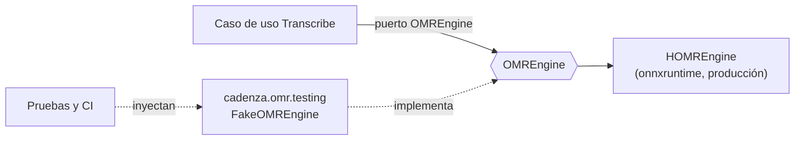

# ADR-0018: HOMR como único motor OMR

- **Estado:** Aceptado
- **Fecha:** 2026-10-20
- **Decisores:** Dirección del proyecto Cadenza
- **Relacionado:** [ADR-0005](ADR-0005-motor-omr-homr-baseline-oemer.md) (reemplaza su punto 3 y precisa el 4), [ADR-0001](ADR-0001-monolito-modular-hexagonal.md), [ADR-0016](ADR-0016-transcripcion-sincrona-vs-asincrona.md)
- **Issue:** [#130](https://github.com/sebdavid3/Cadenza/issues/130)

---

## Contexto

[ADR-0005](ADR-0005-motor-omr-homr-baseline-oemer.md) adoptó HOMR como motor
principal y previó dos adaptadores más detrás del puerto `OMREngine`: `oemer`
como línea base para la comparación experimental y un motor de prueba para la
suite. En la práctica, el 2026-10-20 había tres motores seleccionables con
`CADENZA_OMR_ENGINE`:

- **`fake`** (`FakeOMREngine`): devuelve siempre la misma partitura sintética.
  Era el valor por defecto de `Settings`, de `.env.example` y de
  `docker-compose.yml`, de modo que una API arrancada sin configurar «transcribía»
  cualquier imagen con datos inventados, y `GET /health` lo anunciaba como motor.
  Además, `exp_01_effort.py` lo usaba en un modo `synthetic_fallback` cuando
  faltaba el corpus, en contra de la regla de integridad de los resultados
  (CLAUDE.md §8.1).
- **`oemer`** (`OemerEngine`): probado solo con dobles y nunca ejecutado sobre el
  corpus (D1, [#100](https://github.com/sebdavid3/Cadenza/issues/100)). `exp_08`
  reportó 100 de 100 fallos porque no existían predicciones, no porque oemer
  fallara.
- **`homr`** (`HOMREngine`): el único motor verificado de punta a punta, en CPU y
  GPU ([#97](https://github.com/sebdavid3/Cadenza/issues/97),
  [#106](https://github.com/sebdavid3/Cadenza/issues/106)).

La dirección del proyecto decidió que Cadenza solo usará HOMR.

## Decisión

1. **HOMR es el único motor OMR de producción.** `Settings` deja de tener
   `omr_engine` y `CADENZA_OMR_ENGINE` deja de existir (si se define, se ignora).
   `create_app` construye `HOMREngine` cuando no se le inyecta un motor, y
   `create_default_app` delega en ese comportamiento. `GET /health` toma el
   nombre del motor de `OMREngine.engine_id`.
2. **Se elimina oemer:** el adaptador `OemerEngine`, sus pruebas, el extra
   `oemer` de `packages/omr`, `exp_08_oemer_baseline.py` y la documentación de uso.
   D1 queda cerrada fuera de alcance y #100 se cierra como «no se hará». Los
   archivos que `exp_08` dejó en `results/` (no versionados) no se tocan.
3. **El motor fake sale del producto y queda como doble de pruebas.** Pasa a
   `cadenza.omr.testing.FakeOMREngine`: no se exporta desde `cadenza.omr`, no se
   puede seleccionar por configuración y solo lo usan las pruebas, que lo
   inyectan explícitamente en `create_app`. Es necesario porque la CI no instala
   HOMR y unos 30 archivos de pruebas necesitan una partitura determinista.
4. **Los experimentos no tienen modo sintético con el motor de prueba:**
   `exp_01_effort.py` falla con un mensaje claro si falta el corpus PrIMuS.

## Consecuencias

### Positivas
- **Sin datos inventados en ejecución:** ninguna configuración de la API puede
  devolver una transcripción sintética como si fuera real.
- **Menos superficie:** desaparece un adaptador sin ejecución real, su extra y
  las dependencias transitivas que arrastraba al `uv.lock`.
- **Pruebas intactas:** la suite y la CI siguen ejercitando validación,
  persistencia, API y plano offline con el doble determinista.
- **El contrato v1 no cambia:** `omr_engine` sigue en todas las respuestas que lo
  tenían; solo cambian las descripciones del campo en `HealthStatusResponse` y
  `ProvenancePayload`.

### Riesgos / costos
- **La tesis pierde la comparación entre motores OMR:** la referencia no asistida
  pasa a ser la salida de HOMR sin corrección humana, ya medida frente a la
  verdad de referencia en `exp_03`. La comparación HOMR frente a oemer prevista en
  ADR-0005 no se hará.
- **Todo despliegue necesita HOMR instalado:** sin el extra `homr`, la API arranca
  y `/health` responde 200, pero `POST /transcribe` responde 500 porque el error
  de importación de HOMR no está mapeado. La imagen Docker de la API
  (`Dockerfile`) no instala HOMR (deuda D50).
- **El doble de pruebas sigue en el paquete instalado** (`cadenza.omr.testing`),
  aunque fuera de la API pública del paquete y de la configuración.

## Alternativas consideradas

1. **Eliminar también el doble de pruebas y probar con HOMR real.** Descartada:
   obligaría a instalar HOMR y sus modelos en la CI y a reescribir unos 30
   archivos de pruebas sobre la salida real del modelo, que no es estable entre
   versiones ni rápida.
2. **Mantener `CADENZA_OMR_ENGINE` con `homr` como único valor válido.**
   Descartada: un selector con una sola opción no aporta nada, y una variable
   antigua con `fake` haría fallar el arranque en lugar de usar el único motor
   disponible.
3. **Conservar oemer como extra opcional sin usarlo.** Descartada: es código sin
   ejecución real que la documentación presentaba como línea base.

## Notas posteriores

- **2026-10-26, Audiveris como motor complementario ([INV-0002](../investigaciones/INV-0002-audiveris-frente-a-homr.md)).**
  Se midió Audiveris 5.11.0 junto a HOMR para leer lo que HOMR no da (matices, el
  numerador y el símbolo del compás, y los tresillos implícitos). Acierta en los
  reguladores de páginas limpias, en ¢ y en los tresillos implícitos, pero no en las
  dinámicas sin OCR, lee peor las notas y tarda 35–51 s por página en CPU. Esta decisión
  sigue vigente: no se integra en la entrega de noviembre de 2026, y su integración como
  fuente de propuestas queda como trabajo futuro
  ([#262](https://github.com/sebdavid3/Cadenza/issues/262)), que necesitaría un ADR que
  modifique este.
