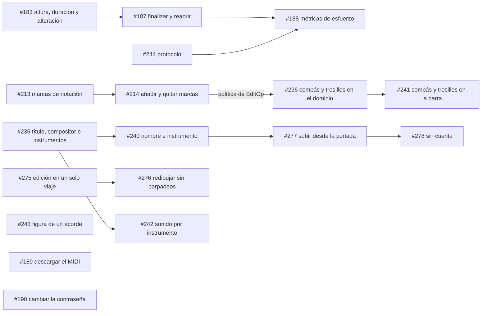

# Fase 8 — Interfaz web (`apps/web`)

**Objetivo:** construir desde cero ([#129](https://github.com/sebdavid3/Cadenza/issues/129))
la interfaz web sobre la API v1 congelada, de modo que una persona pueda transcribir una
partitura, revisarla, corregirla, cerrarla y exportarla en el navegador, y que el estudio
de esfuerzo pueda medir esa corrección.

Referencias:
- [`../../ARCHITECTURE.md`](../../ARCHITECTURE.md): §5 (Módulo 3) y §10.
- ADR: [ADR-0006](../../adr/ADR-0006-render-editor-osmd-verovio-zustand.md) y de
  [ADR-0019](../../adr/ADR-0019-base-del-cliente-web.md) a
  [ADR-0035](../../adr/ADR-0035-descartar-restaurar-y-revalidar-desde-la-vista.md).
- Guía de integración: [`../../api/frontend-handoff.md`](../../api/frontend-handoff.md).
- Producto y diseño: [`../../../PRODUCT.md`](../../../PRODUCT.md) y
  [`../../../DESIGN.md`](../../../DESIGN.md).
- Estado vivo: [`../../PROJECT_STATE.md`](../../PROJECT_STATE.md).

Seguimiento: milestones
[Fase 8: Interfaz web (apps/web)](https://github.com/sebdavid3/Cadenza/milestone/3) y
[Despliegue público (homelab)](https://github.com/sebdavid3/Cadenza/milestone/4). Plan de cierre:
[`../plan_de_cierre/README.md`](../plan_de_cierre/README.md).

---

## Hecho

| Tanda | Issues | Contenido | ADR |
|---|---|---|---|
| 1 | [#144](https://github.com/sebdavid3/Cadenza/issues/144)–[#147](https://github.com/sebdavid3/Cadenza/issues/147) | Base del cliente, landing, acceso y transcripción por lotes con el listado de sesiones | ADR-0019, ADR-0020 |
| 2 | [#152](https://github.com/sebdavid3/Cadenza/issues/152)–[#155](https://github.com/sebdavid3/Cadenza/issues/155) | MusicXML fiel al `ScoreIR`; vista de solo lectura con OSMD y posibles errores por compás; registro de cuentas y moderación | ADR-0021, ADR-0022 |
| Despliegue | [#156](https://github.com/sebdavid3/Cadenza/issues/156), [#157](https://github.com/sebdavid3/Cadenza/issues/157), [#159](https://github.com/sebdavid3/Cadenza/issues/159), [#165](https://github.com/sebdavid3/Cadenza/issues/165), [#166](https://github.com/sebdavid3/Cadenza/issues/166), [#169](https://github.com/sebdavid3/Cadenza/issues/169), [#174](https://github.com/sebdavid3/Cadenza/issues/174), [#180](https://github.com/sebdavid3/Cadenza/issues/180) | Publicación en `https://r2d2.tailcacb19.ts.net`, transcripciones simultáneas, confirmación antes de responder, registro abierto y copias diarias | ADR-0023, ADR-0024, ADR-0025 |
| 3 | [#176](https://github.com/sebdavid3/Cadenza/issues/176), [#177](https://github.com/sebdavid3/Cadenza/issues/177) | Descarga del MusicXML y reproducción con Tone.js, con el compás que suena resaltado | ADR-0026 |
| 4 (en curso) | [#182](https://github.com/sebdavid3/Cadenza/issues/182), [#183](https://github.com/sebdavid3/Cadenza/issues/183), [#213](https://github.com/sebdavid3/Cadenza/issues/213), [#218](https://github.com/sebdavid3/Cadenza/issues/218), [#184](https://github.com/sebdavid3/Cadenza/issues/184), [#185](https://github.com/sebdavid3/Cadenza/issues/185), [#186](https://github.com/sebdavid3/Cadenza/issues/186) | Seleccionar una nota o un silencio sobre la partitura con el ratón, el teclado o los pasos de la barra, con su ancla: mapa ancla→caja por evento emparejado con lo que dibuja OSMD (D11 resuelta). Corregir su altura, su duración y su alteración con botones o con el teclado, con `base_seq`, sin envío optimista y con el 409 recargado. Guardar y mostrar las articulaciones, los calderones, las ligaduras de expresión, las dinámicas y los reguladores, sin cambiar las anclas ni las métricas de los experimentos. Conservar el ritmo de varias voces (el hueco de una voz es un silencio invisible) y dibujarlas con las plicas separadas. Insertar y borrar notas y silencios, y cambiar la clave y la armadura del compás elegido, con el mismo flujo. Deshacer en el servidor y rehacer reenviando la edición deshecha, con las pilas leídas del log, el teclado fuera de los campos de texto y la historia de ediciones. Descartar cada posible error como falso positivo con su motivo, restaurarlo y revalidar tras corregir, con las marcas del estado nuevo y sin prometer que la transcripción esté bien | ADR-0027, ADR-0030, ADR-0031, ADR-0032, ADR-0033, ADR-0034, ADR-0035 |

Queda pendiente la escucha manual de la reproducción por el responsable, en escritorio y en
móvil: un navegador sin interfaz no la oye.

## Siguientes etapas

El alcance final y el calendario los fija el plan de cierre
([`../plan_de_cierre/README.md`](../plan_de_cierre/README.md),
[#231](https://github.com/sebdavid3/Cadenza/issues/231)): esta fase entra en el congelado del
2026-11-08, salvo #277, #189, #190 y #278, que no afectan al estudio y se despliegan después.

| Etapa | Issue | Contenido | Depende de | Deuda |
|---|---|---|---|---|
| **Corrección** | ~~[#182](https://github.com/sebdavid3/Cadenza/issues/182)~~ | **Hecho:** seleccionar una nota sobre la partitura, con el mapa ancla→caja por evento (ADR-0027) | — | D11 (resuelta) |
| | ~~[#183](https://github.com/sebdavid3/Cadenza/issues/183)~~ | **Hecho:** corregir la altura, la duración y la alteración (`base_seq`, 409, 422; ADR-0030) | #182 | D61 (nueva: la figura de un acorde) |
| | ~~[#213](https://github.com/sebdavid3/Cadenza/issues/213)~~ | **Hecho:** guardar y mostrar las marcas de notación; deshacer un borrado las devuelve (ADR-0031) | #183 | — |
| | ~~[#218](https://github.com/sebdavid3/Cadenza/issues/218)~~ | **Hecho:** varias voces con su ritmo (huecos como silencios invisibles), plicas separadas y sin el error falso de balance (ADR-0032) | #213 | D63 (resuelta), D62 (diagnosticada) |
| | ~~[#184](https://github.com/sebdavid3/Cadenza/issues/184)~~ | **Hecho:** insertar y borrar eventos, y cambiar la clave y la armadura (ADR-0033) | #183, #213, #218 | D61 (ampliada: la primera nota de un acorde), D62 (sin selección tampoco se edita) |
| | ~~[#185](https://github.com/sebdavid3/Cadenza/issues/185)~~ | **Hecho:** deshacer en el servidor y rehacer, con la historia de ediciones (ADR-0034) | #183 | — |
| | ~~[#186](https://github.com/sebdavid3/Cadenza/issues/186)~~ | **Hecho:** descartar, restaurar y revalidar los posibles errores (ADR-0035) | #183 | D64 |
| | ~~[#214](https://github.com/sebdavid3/Cadenza/issues/214)~~ | **Hecho:** añadir y quitar articulaciones, calderón, dinámicas, ligaduras de expresión y reguladores desde la barra, con teclado (ADR-0039); es la forma de poner los matices | #213 | — |
| | [#241](https://github.com/sebdavid3/Cadenza/issues/241) | Cambiar el compás (números, C o ¢) y poner tresillos desde la barra de corrección | [#236](https://github.com/sebdavid3/Cadenza/issues/236) | — |
| | [#243](https://github.com/sebdavid3/Cadenza/issues/243) | Cambiar la figura de un acorde entero | — | D61 |
| | ~~[#275](https://github.com/sebdavid3/Cadenza/issues/275)~~ | **Hecho:** una edición en un solo viaje: la respuesta trae el estado nuevo, con caché del estado materializado y `Server-Timing` (ADR-0037) | — | D66 |
| | ~~[#276](https://github.com/sebdavid3/Cadenza/issues/276)~~ | **Hecho:** redibujar en una sola instancia de OSMD sin perder la nota elegida, una orden en espera mientras se guarda y la reproducción que sigue (ADR-0038) | #275 | D67 |
| **Datos de la partitura** | ~~[#235](https://github.com/sebdavid3/Cadenza/issues/235)~~ | **Hecho:** título, compositor e instrumento de cada parte en la API, el MusicXML y el MIDI (ADR-0041) | — | — |
| | [#240](https://github.com/sebdavid3/Cadenza/issues/240) | Nombre e instrumento antes de transcribir; el nombre es el de la sesión | #235 | — |
| **Portada** | [#277](https://github.com/sebdavid3/Cadenza/issues/277) | Subir una imagen y ver su transcripción desde la portada; para editar, se entra a la sesión | #240 | — |
| | [#278](https://github.com/sebdavid3/Cadenza/issues/278) | Transcribir sin cuenta desde la portada y entrar para editar; se despliega después del estudio | #277, #248 | — |
| **Reproducción** | [#242](https://github.com/sebdavid3/Cadenza/issues/242) | Que cada parte suene con su instrumento | #235 | — |
| **Cierre** | ~~[#187](https://github.com/sebdavid3/Cadenza/issues/187)~~ | **Hecho:** finalizar y reabrir una sesión; finalizar conserva los descartes (ADR-0043) | #183 | D65 (resuelta) |
| | [#188](https://github.com/sebdavid3/Cadenza/issues/188) | Registrar las métricas de esfuerzo según el protocolo, con las definiciones que cierre [#244](https://github.com/sebdavid3/Cadenza/issues/244) | #187, #244 | D38 |
| | [#189](https://github.com/sebdavid3/Cadenza/issues/189) | Descargar el MIDI | — | — |
| **Cuenta** | [#190](https://github.com/sebdavid3/Cadenza/issues/190) | Cambiar la contraseña | — | — |
| **Deuda** | ~~[#191](https://github.com/sebdavid3/Cadenza/issues/191)~~ | **Hecho:** excluir del dataset las sesiones de cuentas autorregistradas | — | D55 (resuelta) |
| | ~~[#192](https://github.com/sebdavid3/Cadenza/issues/192)~~ | **Hecho:** la imagen de la API sin ejecutarse como root | — | D57 (resuelta) |
| | ~~[#193](https://github.com/sebdavid3/Cadenza/issues/193)~~ | **Hecho:** longitud mínima de `CADENZA_AUTH_SECRET_KEY` | — | D58 (resuelta) |

Lo que esta fase necesita de otras: [#236](https://github.com/sebdavid3/Cadenza/issues/236)
(Fase 9) para #241; [#244](https://github.com/sebdavid3/Cadenza/issues/244) (Fase 10) para
#188; y [#248](https://github.com/sebdavid3/Cadenza/issues/248) (Fase 10) para #278. Los PR que regeneran el contrato se fusionan de uno en uno: #214 → #235 → #275 → #236 → #256 → #258 (Fase 11) → #243 (si cambia el contrato) → #278.

## Fuera de alcance

Fuera de la entrega de noviembre de 2026 (milestone «Trabajo futuro», plan de cierre):

- Matices reconocidos automáticamente con Audiveris
  ([#262](https://github.com/sebdavid3/Cadenza/issues/262),
  [INV-0002](../../investigaciones/INV-0002-audiveris-frente-a-homr.md)); se ponen a mano con #214.
- Volumen de la reproducción según los matices ([#215](https://github.com/sebdavid3/Cadenza/issues/215)).
- Título y letra leídos de la imagen ([#263](https://github.com/sebdavid3/Cadenza/issues/263)).
- D62 y D64 ([#264](https://github.com/sebdavid3/Cadenza/issues/264)) y las políticas completas
  del registro abierto ([#194](https://github.com/sebdavid3/Cadenza/issues/194); para el estudio,
  [#248](https://github.com/sebdavid3/Cadenza/issues/248) lo cierra).
- Evaluación sobre SMB y MUSCIMA++ ([#102](https://github.com/sebdavid3/Cadenza/issues/102)) y
  reentrenar HOMR ([#103](https://github.com/sebdavid3/Cadenza/issues/103), D14 y D53).
- Marcas sobre la imagen original: HOMR no da coordenadas por nota (INV-0001).
- Entrada PDF y partituras de varias páginas ([#38](https://github.com/sebdavid3/Cadenza/issues/38)).

El estudio de esfuerzo con participantes (D38) ya no va después de esta fase: es la Fase 10 del
plan de cierre ([#253](https://github.com/sebdavid3/Cadenza/issues/253)), con el sistema
congelado el 2026-11-08.

## Criterio de cierre

1. Desde la interfaz, una persona transcribe con el título, el compositor y los instrumentos;
   revisa; corrige con todas las operaciones de `EditOp` (las siete de hoy y las que añadan
   #214, #236 y #243); deshace y rehace; gestiona los posibles errores; finaliza; reabre; y
   exporta a MusicXML y MIDI. Cada parte suena con su instrumento. Se verifica contra la API
   real con HOMR a 1440 y 390 px y en el despliegue público.
2. Las métricas de esfuerzo se registran como pide el protocolo, y las sesiones de cuentas del
   registro no llegan ni al estudio ni al dataset (D55).
3. D11 queda resuelta y cada decisión tiene su ADR.
4. Las puertas de CLAUDE.md §6 están en verde y el responsable ha escuchado la reproducción.
