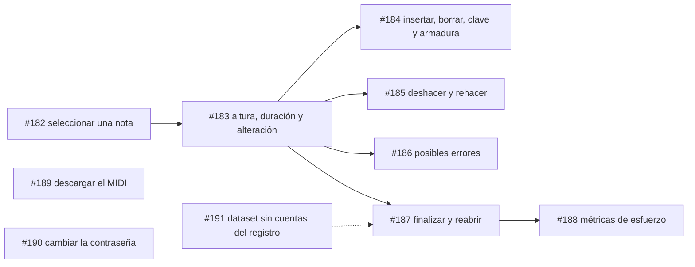

# Fase 8 — Interfaz web (`apps/web`)

**Objetivo:** construir desde cero ([#129](https://github.com/sebdavid3/Cadenza/issues/129))
la interfaz web sobre la API v1 congelada, de modo que una persona pueda transcribir una
partitura, revisarla, corregirla, cerrarla y exportarla en el navegador, y que el estudio
de esfuerzo pueda medir esa corrección.

Referencias:
- [`../../ARCHITECTURE.md`](../../ARCHITECTURE.md): §5 (Módulo 3) y §10.
- ADR: [ADR-0006](../../adr/ADR-0006-render-editor-osmd-verovio-zustand.md) y de
  [ADR-0019](../../adr/ADR-0019-base-del-cliente-web.md) a
  [ADR-0026](../../adr/ADR-0026-reproduccion-de-la-partitura-en-el-navegador.md).
- Guía de integración: [`../../api/frontend-handoff.md`](../../api/frontend-handoff.md).
- Producto y diseño: [`../../../PRODUCT.md`](../../../PRODUCT.md) y
  [`../../../DESIGN.md`](../../../DESIGN.md).
- Estado vivo: [`../../PROJECT_STATE.md`](../../PROJECT_STATE.md).

Seguimiento: milestones
[Fase 8: Interfaz web (apps/web)](https://github.com/sebdavid3/Cadenza/milestone/3) y
[Despliegue público (homelab)](https://github.com/sebdavid3/Cadenza/milestone/4).

---

## Hecho

| Tanda | Issues | Contenido | ADR |
|---|---|---|---|
| 1 | [#144](https://github.com/sebdavid3/Cadenza/issues/144)–[#147](https://github.com/sebdavid3/Cadenza/issues/147) | Base del cliente, landing, acceso y transcripción por lotes con el listado de sesiones | ADR-0019, ADR-0020 |
| 2 | [#152](https://github.com/sebdavid3/Cadenza/issues/152)–[#155](https://github.com/sebdavid3/Cadenza/issues/155) | MusicXML fiel al `ScoreIR`; vista de solo lectura con OSMD y posibles errores por compás; registro de cuentas y moderación | ADR-0021, ADR-0022 |
| Despliegue | [#156](https://github.com/sebdavid3/Cadenza/issues/156), [#157](https://github.com/sebdavid3/Cadenza/issues/157), [#159](https://github.com/sebdavid3/Cadenza/issues/159), [#165](https://github.com/sebdavid3/Cadenza/issues/165), [#166](https://github.com/sebdavid3/Cadenza/issues/166), [#169](https://github.com/sebdavid3/Cadenza/issues/169), [#174](https://github.com/sebdavid3/Cadenza/issues/174), [#180](https://github.com/sebdavid3/Cadenza/issues/180) | Publicación en `https://r2d2.tailcacb19.ts.net`, transcripciones simultáneas, confirmación antes de responder, registro abierto y copias diarias | ADR-0023, ADR-0024, ADR-0025 |
| 3 | [#176](https://github.com/sebdavid3/Cadenza/issues/176), [#177](https://github.com/sebdavid3/Cadenza/issues/177) | Descarga del MusicXML y reproducción con Tone.js, con el compás que suena resaltado | ADR-0026 |
| 4 (en curso) | [#182](https://github.com/sebdavid3/Cadenza/issues/182) | Seleccionar una nota o un silencio sobre la partitura con el ratón, el teclado o los pasos de la barra, con su ancla: mapa ancla→caja por evento emparejado con lo que dibuja OSMD (D11 resuelta) | ADR-0027 |

Queda pendiente la escucha manual de la reproducción por el responsable, en escritorio y en
móvil: un navegador sin interfaz no la oye.

## Siguientes etapas

| Etapa | Issue | Contenido | Depende de | Deuda |
|---|---|---|---|---|
| **Corrección** | ~~[#182](https://github.com/sebdavid3/Cadenza/issues/182)~~ | **Hecho:** seleccionar una nota sobre la partitura, con el mapa ancla→caja por evento (ADR-0027) | — | D11 (resuelta) |
| | [#183](https://github.com/sebdavid3/Cadenza/issues/183) | Corregir la altura, la duración y la alteración (`base_seq`, 409, 422) | #182 | — |
| | [#184](https://github.com/sebdavid3/Cadenza/issues/184) | Insertar y borrar eventos, y cambiar la clave y la armadura | #183 | — |
| | [#185](https://github.com/sebdavid3/Cadenza/issues/185) | Deshacer en el servidor y rehacer (ADR-0006, ADR-0007) | #183 | — |
| | [#186](https://github.com/sebdavid3/Cadenza/issues/186) | Descartar, restaurar y revalidar los posibles errores | #183 | — |
| **Cierre** | [#187](https://github.com/sebdavid3/Cadenza/issues/187) | Finalizar y reabrir una sesión | #183 | — |
| | [#188](https://github.com/sebdavid3/Cadenza/issues/188) | Registrar las métricas de esfuerzo según el protocolo | #183, #187 | D38 |
| | [#189](https://github.com/sebdavid3/Cadenza/issues/189) | Descargar el MIDI | — | — |
| **Cuenta** | [#190](https://github.com/sebdavid3/Cadenza/issues/190) | Cambiar la contraseña | — | — |
| **Deuda** | ~~[#191](https://github.com/sebdavid3/Cadenza/issues/191)~~ | **Hecho:** excluir del dataset las sesiones de cuentas autorregistradas | conviene antes de #187 | D55 (resuelta) |
| | ~~[#192](https://github.com/sebdavid3/Cadenza/issues/192)~~ | **Hecho:** la imagen de la API sin ejecutarse como root | — | D57 (resuelta) |
| | ~~[#193](https://github.com/sebdavid3/Cadenza/issues/193)~~ | **Hecho:** longitud mínima de `CADENZA_AUTH_SECRET_KEY` | — | D58 (resuelta) |
| | [#194](https://github.com/sebdavid3/Cadenza/issues/194) | Límites del registro abierto: **alcance por decidir** | decisión del responsable | D59 |

## Fuera de alcance

- Evaluación sobre SMB y MUSCIMA++ ([#102](https://github.com/sebdavid3/Cadenza/issues/102)) y
  ajuste fino real del modelo OMR ([#103](https://github.com/sebdavid3/Cadenza/issues/103), D14
  y D53): alcance por decidir, fuera de la Fase 8.
- Marcas sobre la imagen original: HOMR no da coordenadas por nota (INV-0001).
- Entrada PDF y partituras de varias páginas ([#38](https://github.com/sebdavid3/Cadenza/issues/38)).
- El estudio de esfuerzo con participantes (D38): va después de esta fase y necesita
  [#188](https://github.com/sebdavid3/Cadenza/issues/188).

## Criterio de cierre

1. Desde la interfaz, una persona transcribe, revisa, corrige con las siete operaciones de
   `EditOp`, deshace y rehace, gestiona los posibles errores, finaliza, reabre y exporta a MusicXML y
   MIDI. Se verifica contra la API real con HOMR a 1440 y 390 px y en el despliegue público.
2. Las métricas de esfuerzo se registran como pide el protocolo, y las sesiones de cuentas del
   registro no llegan ni al estudio ni al dataset (D55).
3. D11 queda resuelta y cada decisión tiene su ADR.
4. Las puertas de CLAUDE.md §6 están en verde y el responsable ha escuchado la reproducción.
