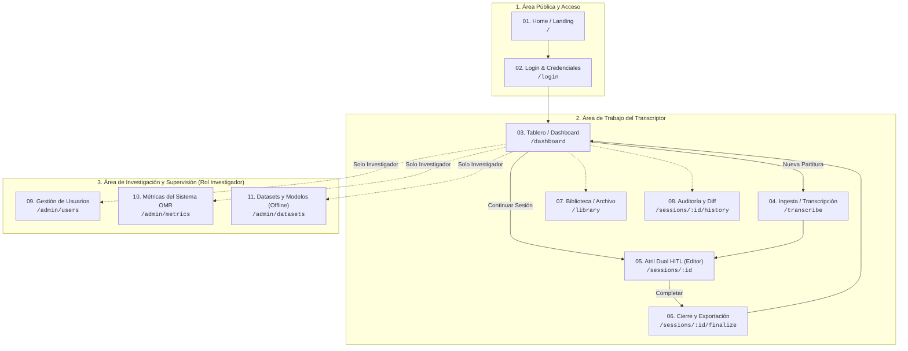

# Ecosistema de Vistas de Cadenza — Especificación de Frontend

Este directorio contiene la especificación funcional, técnica, visual y de interacción para cada una de las **11 vistas** que componen la suite web de **Cadenza** (`apps/web`).

Cada documento sirve como el plano de construcción (*blueprint*) para la implementación en React 18 / TypeScript, rigiéndose estrictamente por:
- La verdad del producto: [`PRODUCT.md`](../../PRODUCT.md).
- El sistema visual "Cadenza Studio Pro": [`DESIGN.md`](../../DESIGN.md).
- El contrato congelado de la API v1: [`docs/api/openapi.json`](../api/openapi.json) y [`docs/api/frontend-handoff.md`](../api/frontend-handoff.md).

---

## Mapa de Vistas y Rutas

---

## Índice de Documentos

| # | Documento | Ruta Frontend | Audiencia | Propósito Central |
|---|---|---|---|---|
| 01 | [`01-home-landing.md`](01-home-landing.md) | `/` | Público / Académica | Presentación institucional de la tesis, pipeline explicativo y acceso. |
| 02 | [`02-autenticacion-login.md`](02-autenticacion-login.md) | `/login` | Transcriptor / Investigador | Acceso seguro con Bearer JWT y cambio de contraseñas (ADR-0012). |
| 03 | [`03-tablero-dashboard.md`](03-tablero-dashboard.md) | `/dashboard` | Transcriptor / Investigador | Centro de mando de sesiones con vista tabla/grid, filtros y búsqueda ⌘K. |
| 04 | [`04-ingesta-transcribe.md`](04-ingesta-transcribe.md) | `/transcribe` | Transcriptor / Investigador | Dropzone de imágenes, selector de motor OMR (HOMR GPU) y monitor de inferencia. |
| 05 | [`05-atril-dual-hitl.md`](05-atril-dual-hitl.md) | `/sessions/:id` | Transcriptor | Núcleo de edición: atril dual (escaneo ↔ OSMD), hallazgos, inspector y audio. |
| 06 | [`06-cierre-exportacion.md`](06-cierre-exportacion.md) | `/sessions/:id/finalize` | Transcriptor / Investigador | Resumen editorial, telemetría de esfuerzo y descarga de MusicXML 4.0 / MIDI. |
| 07 | [`07-biblioteca-archivo.md`](07-biblioteca-archivo.md) | `/library` | Transcriptor / Investigador | Catálogo permanente de obras verificadas para consulta rápida y descarga. |
| 08 | [`08-historial-auditoria-diff.md`](08-historial-auditoria-diff.md) | `/sessions/:id/history` | Investigador / Transcriptor | Trazabilidad forense: log append-only inmutable y comparador diff visual. |
| 09 | [`09-gestion-usuarios-roles.md`](09-gestion-usuarios-roles.md) | `/admin/users` | Exclusivo Investigador | Directorio de usuarios, altas de transcriptores, cambio de roles y permisos. |
| 10 | [`10-metricas-evaluacion-omr.md`](10-metricas-evaluacion-omr.md) | `/admin/metrics` | Exclusivo Investigador | Tablero científico: latencias GPU/CPU, precisión de reglas y experimentos. |
| 11 | [`11-datasets-modelos-offline.md`](11-datasets-modelos-offline.md) | `/admin/datasets` | Exclusivo Investigador | Empaquetado de tripletas corregidas para aprendizaje activo y reentrenamiento. |

---

## Invariantes Transversales a Todas las Vistas

1. **Dark Mode Nativo:** Todas las vistas (salvo el lienzo de partitura de OSMD y el escaneo) se renderizan sobre `#0C0D0F` y `#141519`.
2. **Command Palette (`Ctrl+K`):** Presente en todas las vistas autenticadas, permitiendo saltar a cualquier pantalla o buscar partituras al instante.
3. **Indicador de Salud de la API:** Header con semáforo sutil consultando periódicamente `GET /health`.
4. **Cero Clichés de IA:** Prohibidos destellos (✨), gráficos circulares de "confianza", degradados púrpuras y términos acústicos como `.wav` o `Hz`.
